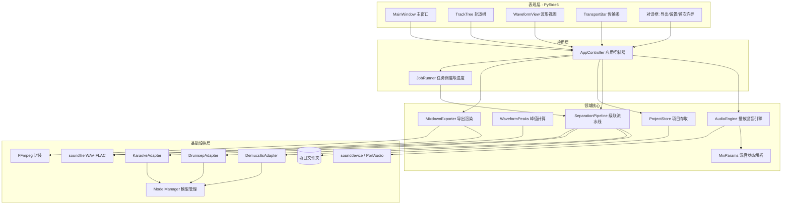
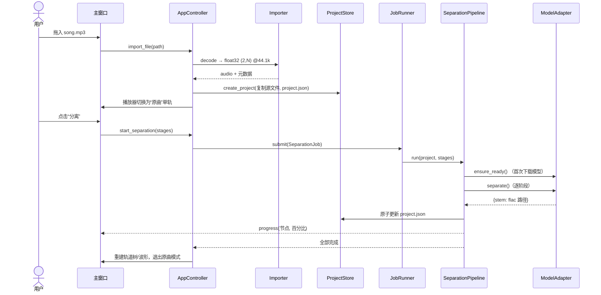
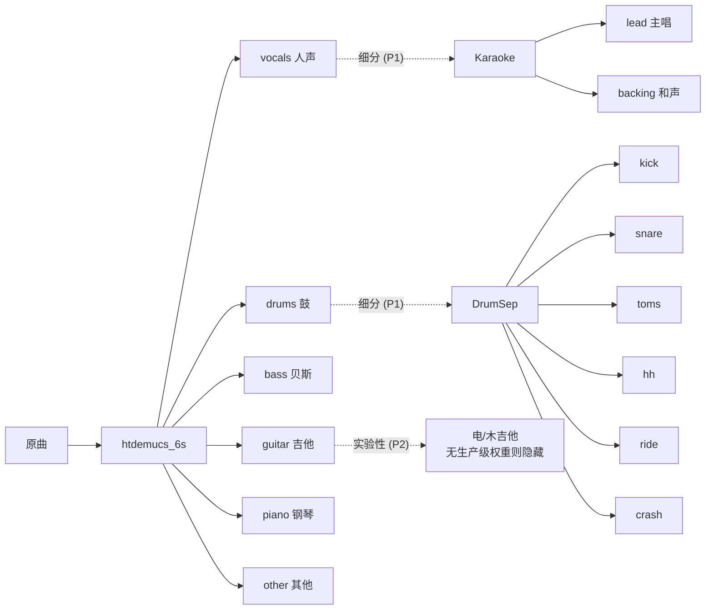

# 音乐分轨处理桌面应用 · 架构设计文档

| 文档信息 | |
|---|---|
| 版本 | v0.1（初稿） |
| 日期 | 2026-11-24 |
| 关联文档 | [需求规格说明书](01-requirements.md) · [开发计划](03-development-plan.md) |
| 状态 | 待评审 |

---

## 1. 设计目标与约束

| 目标 | 说明 |
|---|---|
| 本地离线 | 除首次下载模型外，运行期完全离线，无网络依赖 |
| 实时混音 | 每轨增益/静音/独奏在播放中实时生效，不重新渲染 |
| 可扩展分轨 | 任意深度的分轨树，新模型通过适配器接入，UI 不感知模型差异 |
| 模型隔离 | 各模型架构（Demucs/MDX/RoFormer）的加载差异被适配器封装 |
| 容错优先 | 分离/导出原子化，中断不破坏既有项目数据 |

主要约束：

- Windows 11 x64 为第一目标；Python 3.11
- 可选 GPU 加速（RTX 4060 8 GB 为基准开发机），无 GPU 可完整使用
- 依赖版本敏感（torch / demucs / audio-separator），需锁定并验证

---

## 2. 技术选型与决策记录（ADR）

| 编号 | 决策 | 主要备选 | 理由 |
|---|---|---|---|
| AD-1 | **桌面应用：Python + PySide6（Qt6）** | Electron/Tauri + Python 后端、本地 Web 页面 | 单语言全栈；模型生态全部在 Python；原生桌面交互无需 IPC；PySide6 为 LGPL，闭源分发无阻碍 |
| AD-2 | **播放引擎：sounddevice + numpy 回调混音** | QAudioSink、QtMultimedia、miniaudio | 直接以 numpy 数组做多轨混音，代码量最小、可控性最强（seek、增益平滑、独奏逻辑都在自己手里） |
| AD-3 | **分离在应用进程内的 QThread 执行** | 子进程隔离执行 | 实现简单、可直接传递 numpy 数组；适配器边界已隔离，若实测稳定性问题可迁移子进程而不改上层 |
| AD-4 | **stem 存盘格式：FLAC（16-bit）** | WAV float32、WAV 16-bit | 无损且体积约为 16-bit WAV 的一半；soundfile 原生支持；播放时解码为 float32 |
| AD-5 | **模型接入：一级 demucs 包 + 二级 audio-separator / msst 推理** | 全部自研模型加载 | 站在成熟生态上，减少模型加载代码；差异由适配器封装 |
| AD-6 | **ffmpeg 作为独立可执行文件分发（LGPL 构建）** | 打包进进程、纯 Python 解码 | 格式覆盖最全；独立进程调用，LGPL 合规边界清晰 |
| AD-7 | **一曲一个自包含项目文件夹** | 全局数据库/素材库 | 简单、可整体备份/迁移；无数据库依赖；易于实现原子落盘 |
| AD-8 | **混音参数整体替换（引用交换），回调无锁读取** | 回调内加锁 | PortAudio 实时回调不得阻塞；Python 属性引用赋值在读侧是原子的 |

---

## 3. 总体架构



### 分层职责

| 层 | 职责 | 约束 |
|---|---|---|
| 表现层 | 渲染 UI、收集用户操作、展示进度与错误 | 不包含业务逻辑，不直接调用模型或音频设备 |
| 应用层 | 编排用例（导入/分离/播放/导出）、任务调度、状态同步 | 所有长操作异步执行，UI 线程永不阻塞 |
| 领域核心 | 混音数学、混音参数解析、分离流水线、项目模型、峰值计算 | 纯 Python + numpy，可单元测试，不依赖 Qt（`AudioEngine` 除外，用 Signal 通知 UI） |
| 基础设施层 | 音频设备、文件编码、ffmpeg、模型下载与推理 | 差异被适配器封装；错误转换为领域异常 |

---

## 4. 模块划分与目录结构

```
Audio_processing/
├── app/
│   ├── main.py                    # 入口：QApplication、DPI、全局异常钩子
│   ├── ui/
│   │   ├── main_window.py         # 主窗口、菜单、工具栏、模块总装
│   │   ├── track_tree.py          # 轨道树（组/子轨、M/S、增益滑杆）
│   │   ├── waveform_view.py       # 多轨波形、播放头、缩放、跟随滚动
│   │   ├── transport_bar.py       # 播放/暂停/停止/定位/主音量
│   │   ├── separation_panel.py    # 分离进度、排队、细分入口
│   │   ├── dialogs/
│   │   │   ├── export_dialog.py
│   │   │   ├── settings_dialog.py
│   │   │   └── first_run_wizard.py
│   │   └── theme.py               # 深/浅色样式与轨道配色
│   ├── core/
│   │   ├── audio_engine.py        # AudioEngine：sounddevice 回调混音播放
│   │   ├── mix_params.py          # TrackMix/MixParams、组规则解析
│   │   ├── mixdown.py             # 混音数学（播放与导出共用同一实现）
│   │   └── waveform_peaks.py      # min/max 多分辨率峰值金字塔
│   ├── separation/
│   │   ├── pipeline.py            # 分离 DAG 编排、临时目录与原子落盘
│   │   ├── job.py                 # 任务队列、QThread 包装、信号
│   │   ├── model_manager.py       # 模型下载/校验/路径/状态
│   │   └── adapters/
│   │       ├── base.py            # SeparationAdapter 协议与公共类型
│   │       ├── demucs6s.py        # htdemucs_6s（一级）
│   │       ├── drumsep.py         # DrumSep（鼓组细分）
│   │       └── karaoke.py         # Karaoke（主唱/和声细分）
│   ├── project/
│   │   ├── project_store.py       # 创建/打开/保存/自动保存/备份恢复
│   │   └── schema.py              # Project / StemNode / MixState（pydantic）
│   ├── io/
│   │   ├── importer.py            # 导入、解码、44.1k/立体声统一
│   │   ├── exporter.py            # 混音渲染、WAV/FLAC/MP3 编码
│   │   └── ffmpeg.py              # 探测、路径解析、子进程封装
│   └── settings.py                # 全局设置（%LOCALAPPDATA%）读写
├── scripts/
│   └── m0_check.py                # M0 环境/性能/质量验证脚本
├── tests/
│   ├── test_mix_params.py
│   ├── test_mixdown.py
│   ├── test_project_store.py
│   └── test_pipeline_fake.py      # 用 FakeAdapter 测流水线
├── docs/
├── assets/
├── vendor/ffmpeg/                 # 分发时放置 ffmpeg.exe / ffprobe.exe
├── pyproject.toml
└── README.md
```

---

## 5. 关键接口与数据模型

### 5.1 分离适配器协议

所有模型（无论 Demucs/MDX/RoFormer）统一通过适配器接入：

```python
# app/separation/adapters/base.py
from pathlib import Path
from typing import Protocol
from numpy.typing import NDArray
import numpy as np

class ProgressFn(Protocol):
    def __call__(self, fraction: float, message: str) -> None: ...

class CancelToken(Protocol):
    def is_set(self) -> bool: ...

class SeparationAdapter(Protocol):
    model_id: str                      # 如 "htdemucs_6s"
    output_stems: tuple[str, ...]      # 如 ("vocals","drums","bass","guitar","piano","other")

    def ensure_ready(self, progress: ProgressFn, cancel: CancelToken) -> None:
        """确保权重已下载并校验（首次会触发下载）。"""

    def separate(
        self,
        input_audio: NDArray[np.float32],   # shape (2, N) @ 44.1kHz
        sample_rate: int,
        out_dir: Path,
        progress: ProgressFn,
        cancel: CancelToken,
    ) -> dict[str, Path]:
        """返回 {stem_key: 落盘后的 FLAC 路径}；取消时清理半成品并 raise SeparationCancelled。"""
```

### 5.2 混音参数模型

```python
# app/core/mix_params.py
from dataclasses import dataclass
from collections.abc import Mapping

@dataclass(frozen=True)
class TrackMix:
    gain_db: float = 0.0
    muted: bool = False
    soloed: bool = False

@dataclass(frozen=True)
class MixParams:
    tracks: Mapping[str, TrackMix]       # 仅叶子轨
    group_gain_db: Mapping[str, float]   # 组 key -> dB
    master_gain_db: float = 0.0
```

有效增益解析规则（需求 FR-303/3.3.2 的实现）：由 `MixParamsResolver` 在 UI 线程把"树 + 用户状态"解析为每叶子轨的 `effective_linear` 与 `audible`，结果封装为不可变 `ResolvedMix`，供回调与导出共用：

```python
@dataclass(frozen=True)
class ResolvedMix:
    gain_linear: Mapping[str, float]   # 叶子 key -> 线性增益（已含组增益；静音/独奏时为 0）
    master_linear: float
```

### 5.3 播放引擎

```python
# app/core/audio_engine.py
class AudioEngine(QObject):
    positionChanged = Signal(float)    # 秒

    def set_stems(self, stems: Mapping[str, NDArray[np.float32]], sr: int) -> None: ...
    def set_mix(self, mix: ResolvedMix) -> None:   # 无锁：整对象引用替换
    def play(self) -> None: ...
    def pause(self) -> None: ...
    def stop(self) -> None: ...
    def seek(self, seconds: float) -> None: ...    # 通过命令队列传给回调
```

回调伪代码（PortAudio 实时线程）：

```python
def _callback(outdata, frames, time_info, status):
    mix = self._mix          # 原子读取不可变对象
    cmds = self._cmd_queue   # 小队列，块首消费（seek/play/pause/stop）
    key = lambda k: mix.gain_linear.get(k, 0.0)

    buf = self._scratch      # 预分配 (frames, 2)
    buf.fill(0.0)
    pos = self._pos
    end = self._end
    n = min(frames, end - pos)

    for stem_key, data in self._stems.items():      # data: (2, N)
        g = key(stem_key)
        if g > 0.0:
            seg = data[:, pos:pos + n].T            # (n, 2) 视图
            buf[:n] += seg * g

    outdata[:] = np.clip(buf * mix.master_linear, -1.0, 1.0)
    self._pos = pos + n
    if self._pos >= end:
        self._playing = False
```

回调线程规则：**不分配大对象、不加锁、不写日志、不调用 Qt**；增益变化由 UI 侧按 50 ms 斜坡写入 `ResolvedMix`（每块更新一次即可）。

### 5.4 项目数据模型

项目文件夹自包含：

```
MySong_project/
├── project.json                  # 唯一元数据（含 .bak 备份）
├── original/song.mp3             # 源文件副本
├── stems/
│   └── htdemucs_6s/              # 一级节点目录（按 model_id 命名）
│       ├── vocals.flac
│       ├── drums.flac
│       ├── ...
│       ├── drums__drumsep/       # 二级节点：父 stem key __ model_id
│       │   ├── kick.flac
│       │   └── ...
│       └── vocals__karaoke/
│           ├── lead.flac
│           └── backing.flac
├── cache/waveform/*.npz          # 峰值缓存
└── exports/                      # 默认导出目录
```

`project.json` 核心结构（pydantic 模型，存 version 便于迁移）：

```json
{
  "version": 1,
  "id": "8f3c…",
  "name": "MySong",
  "created_at": "2026-11-24T18:40:00",
  "source": {
    "path": "original/song.mp3",
    "sha256": "…",
    "duration_s": 214.3,
    "sample_rate": 44100,
    "channels": 2
  },
  "stems": {
    "htdemucs_6s": {
      "parent": null,
      "model_id": "htdemucs_6s",
      "created_at": "…",
      "files": {
        "vocals": "stems/htdemucs_6s/vocals.flac",
        "drums": "stems/htdemucs_6s/drums.flac",
        "bass": "stems/htdemucs_6s/bass.flac",
        "guitar": "stems/htdemucs_6s/guitar.flac",
        "piano": "stems/htdemucs_6s/piano.flac",
        "other": "stems/htdemucs_6s/other.flac"
      },
      "children": {
        "drums": { "model_id": "drumsep_mdx23c", "files": { "kick": "…", "snare": "…" } },
        "vocals": { "model_id": "karaoke_melroformer", "files": { "lead": "…", "backing": "…" } }
      }
    }
  },
  "mix": {
    "tracks": {
      "vocals": { "gain_db": 0.0, "muted": false, "soloed": false }
    },
    "group_gain_db": { "drums": 0.0, "vocals": 0.0 },
    "master_gain_db": 0.0
  },
  "active_expansions": ["drums", "vocals"]
}
```

`stems` 为节点字典（key 建议 `"<父key>__<model_id>"` 全局唯一）；`children` 指向子节点。播放时只加载**当前生效的叶子轨**（展开的组用子轨替代父轨），父轨数组不常驻内存。

---

## 6. 关键流程

### 6.1 导入与分离



### 6.2 级联细分依赖树



流水线按需求选择节点，拓扑序执行；每个节点输入为**其父 stem 的音频**（不是原曲），信号更干净：

1. 解析任务：根据用户勾选的细分目标生成节点集合
2. 对每个节点的适配器 `ensure_ready()`（缺模型则先下载）
3. 写临时目录 `stems/<node>/.tmp/` → 全部完成后再原子重命名
4. 更新 `project.json`（先写 `.bak` → 写主文件 → 校验）
5. 任一节点失败：该节点标记失败并清理临时目录，已完成的父节点/兄弟节点结果保留

### 6.3 播放与调音

- UI 拖动滑块 → 更新 `MixState` → `MixParamsResolver.resolve()` → 生成不可变 `ResolvedMix` → `AudioEngine.set_mix()`（引用替换）
- 回调每块读取当前 `ResolvedMix`，多轨求和后钳制输出
- 播放/暂停/跳转通过 `queue.Queue` 向回调传递命令，避免竞态
- 需求 3.3.2 的组规则全部在 `MixParamsResolver` 中实现，回调只认叶子线性增益

### 6.4 导出

导出与播放共用 `mixdown.py` 中的求和逻辑（同一份增益数学，保证"听到什么就导出什么"）：

1. 读取生效叶子轨 FLAC → float32 数组（与播放相同的加载器）
2. 分块求和 `mixdown_chunk(leaf_arrays, resolved_mix)`，写入目标文件
3. 可选峰值归一化：先扫描总峰值，再按 `1/peak` 缩放（两遍处理，内存不翻倍）
4. WAV/FLAC 用 soundfile 直接写；MP3 写入临时 WAV 后调用 ffmpeg 转码
5. 导出全程在后台线程，支持取消（删除临时文件）

---

## 7. 线程与并发模型

| 线程 | 归属 | 职责 | 约束 |
|---|---|---|---|
| Qt GUI 主线程 | QApplication | UI 渲染、事件、状态解析 | 禁止任何 >100 ms 的阻塞操作 |
| SeparationWorker | QThread（单实例） | 模型加载与推理 | 独占 GPU；同一时间只跑一个分离任务；其余排队 |
| ExportWorker | QThread | 混音渲染与编码 | 只读访问 stem 数组 |
| PeakWorker | QThreadPool | 波形峰值计算 | 低优先级，可与分离并发 |
| PortAudio 回调线程 | sounddevice | 实时混音输出 | 无锁、无大分配、无 Qt/日志调用 |

数据共享规则：

- stem 数组加载后**只读**，所有线程可安全共享
- 混音参数通过不可变对象的引用整体替换实现无锁读取
- 项目文件只由 ProjectStore 在 UI/工作线程串行写，写入使用临时文件 + 原子重命名

---

## 8. 模型管理

| model_id | 架构 | 输出 | 层级 | 权重来源 | 许可 | 体积（约） |
|---|---|---|---|---|---|---|
| `htdemucs_6s` | Hybrid Transformer Demucs | vocals/drums/bass/guitar/piano/other | 一级 | demucs 包自动下载 | MIT | 100 MB 级 |
| `drumsep_mdx23c` | MDX23C | kick/snare/toms/hh/ride/crash | 鼓细分 | ZFTurbo 预训练清单中的 DrumSep 权重 | 以权重页为准，发布前复核 | 100 MB 级 |
| `karaoke_melroformer`（备选 `uvr_mdxnet_kara2`） | Mel-Band RoFormer / MDX | lead/backing | 人声细分 | audio-separator 模型库 | 以权重页为准，发布前复核 | 数十~数百 MB 级 |
| （未定） | 待评估 | acoustic_guitar / electric_guitar | 吉他实验 | 无生产级开源权重 | — | — |

- 模型缓存目录：`%LOCALAPPDATA%/AudioProcessing/models/{demucs,uvr,msst}`，设置中可迁移
- 下载：显示大小/进度/取消；完成后做校验和；支持"离线导入模型文件夹"
- 版本锁定：model_id 在代码中与权重版本绑定，升级模型视为显式变更（需回归测试）
- 首次运行向导：检查/下载一级模型；二级模型在首次使用对应细分时按需下载

---

## 9. 性能设计

### 9.1 时间预算（RTX 4060 Laptop 8 GB 基准，M0 实测校准）

| 操作 | 目标 | 说明 |
|---|---|---|
| 六轨分离（4 分钟歌曲） | 30~60 s | `htdemucs_6s`，CUDA，fp32 |
| 鼓组细分 | 10~20 s | 输入仅为鼓轨 |
| 人声细分 | 10~20 s | 输入仅为人声轨 |
| 项目打开（含缓存） | < 5 s | 并行加载 FLAC + 峰值缓存 |
| 混音导出（4 分钟） | < 10 s | 分块求和 + 写盘 |

### 9.2 内存核算

- 立体声 float32：`44100 × 秒数 × 2 声道 × 4 字节 ≈ 0.353 MB/s`
- 5 分钟歌曲每条叶子轨 ≈ 106 MB；6 条叶子轨 ≈ **636 MB**（满足 NFR-2）
- 展开细分后叶子数量增加，但子轨总时长与父轨一致，内存基本不变（父轨从播放集卸载）
- 峰值金字塔：每轨 3 级（256/1024/4096 采样），npz 缓存总计 < 10 MB

### 9.3 其他优化点

- `htdemucs_6s` 使用 demucs API 的默认分段策略；M0 实测后可调整 `segment` 与 `overlap` 换质量/速度平衡
- 波形渲染使用 pyqtgraph 降采样绘制，只在视口范围取峰值数据
- 导出分块处理（块 1~2 秒），避免一次性产生巨大中间数组
- 首次分离后 torch 模型常驻内存（应用生命周期内复用），避免重复加载

---

## 10. 错误处理与降级策略

| 故障 | 检测方式 | 用户反馈 | 技术降级 |
|---|---|---|---|
| ffmpeg 缺失 | 启动/导入时探测 | 提示安装或指定路径，给出设置入口 | 仅 WAV/FLAC 可用 |
| CUDA 可用但 OOM | torch OutOfMemoryError | 提示切换 CPU 重试 | 释放缓存后重试一次，再失败则等待用户选择 |
| 模型下载失败 | 请求异常/校验失败 | 显示原因、重试、离线导入入口 | 阻止该功能，其余功能正常 |
| 磁盘空间不足 | 分离前估算 + 写入异常 | 提示所需空间 | 中止任务并清理临时目录 |
| project.json 损坏 | 加载解析异常 | 提示从备份恢复 | 自动尝试 `.bak` |
| 音频解码失败 | ffmpeg/解码异常 | 明确是"文件损坏或不支持" | 不创建项目 |
| 导出中断 | 取消/异常 | 提示未完成 | 删除目标临时文件，不留下半成品 |

统一约定：领域异常层级 `AppError → UserActionRequired / RetryableError / FatalError`，UI 只负责把异常映射为对话框文案。

---

## 11. 打包与发布

| 项 | 方案 |
|---|---|
| 打包工具 | PyInstaller `--onedir`（启动快、便于增量替换 DLL） |
| torch 处理 | 打包 CUDA 版 wheel；`hiddenimports` 覆盖 torch/demucs；排除测试与文档 |
| 模型 | **不打包**，首次运行向导下载到 `%LOCALAPPDATA%` |
| ffmpeg | `vendor/ffmpeg/` 放置 LGPL 构建的 exe；缺失时回退 PATH |
| 安装器 | Inno Setup（可选，M3） |
| 体积预估 | 含 CUDA torch 约 3~5 GB；另提供 CPU-only 构建（约 1~1.5 GB，速度慢） |
| 升级策略 | 应用与模型分离升级；模型目录不受应用升级影响 |

---

## 12. 测试策略

| 层级 | 内容 | 工具 |
|---|---|---|
| 单元测试 | 增益/静音/独奏/组规则真值表；混音求和数学；峰值金字塔；项目读写回环 | pytest |
| 集成测试 | 用 `FakeAdapter` 走通"导入→分离→播放数据装载→导出"全流程 | pytest |
| 模型冒烟 | 10 秒固定素材跑真实模型，校验输出轨数与时长 | pytest -m gpu（手动） |
| 听感测试 | 3 首参考曲（流行/钢琴/电子）按 1~5 分记录串音与伪影，存入 `docs/quality-log.md` | 人工 |
| UI 手工测试 | 见开发计划中的 QA 清单 | 人工 |
| 性能测试 | `scripts/m0_check.py` 计时并记录 | 手动 |

---

## 13. 风险登记表

| 编号 | 风险 | 可能性 | 影响 | 缓解 |
|---|---|---|---|---|
| R-1 | torch/demucs/audio-separator 依赖冲突 | 高 | 高 | M0 先锁定可用的版本组合；依赖面最小化；必要时分离到子进程 |
| R-2 | PyInstaller 打包 torch 失败 | 中 | 高 | M1 末尾提前做打包 spike，不拖到 M3 |
| R-3 | 二级模型权重下架/失效 | 中 | 中 | 首载后本地镜像；记录校验和；离线导入 |
| R-4 | 长歌曲内存占用超预算 | 中 | 中 | 预估提示；只加载叶子轨；后续可做流式播放 |
| R-5 | 分离质量低于用户预期 | 高 | 中 | 产品内质量声明；听感基准测试；引导合理预期 |
| R-6 | 显卡驱动/CUDA 版本差异 | 中 | 中 | 打包内置 CUDA 运行时；CPU 降级路径始终可用 |
| R-7 | 音频设备采样率不支持 44.1k | 低 | 中 | 输出流式重采样（soxr），M1 验证 |

---

## 14. 开放设计问题

| 编号 | 问题 | 何时决定 |
|---|---|---|
| O-1 | 分离是否迁移到子进程（崩溃隔离/依赖隔离） | M1 稳定性评估后 |
| O-2 | 循环区间（A/B）与区域导出 | v0.3 |
| O-3 | 项目库视图与封面 | 视需求 Q-1 |
| O-4 | 每轨 pan/立体声宽度（数据模型已预留扩展点） | v0.3 |
| O-5 | 中英双语 UI | 视需求 Q-4 |
